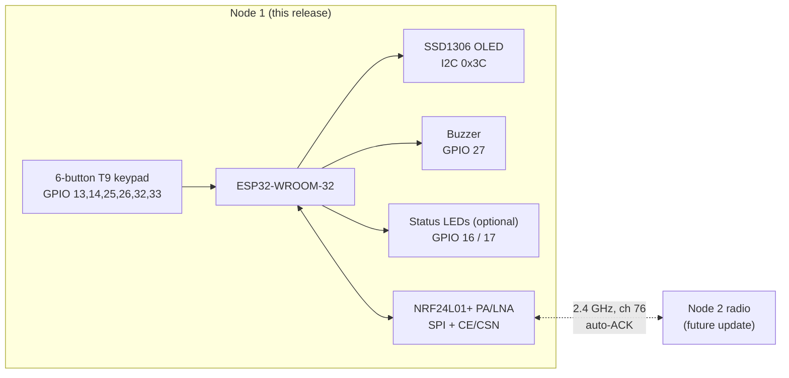

  

# LongRangeText 📡

*A DIY ESP32-based wireless text communicator using NRF24L01+ PA/LNA, a 0.96-inch OLED and a six-button T9 keypad.*

> **Type locally. Send wirelessly. Build your own communicator.**

> ⚠️ **Node 1 firmware is the only node implementation currently included. Node 2 firmware will be added in a future update.**
> ⚠️ **A compatible Node 2 is required for end-to-end radio messaging.**
> ⚠️ The current release is a **prototype**, not a certified commercial communication device.

---

## Table of contents

1. [Project overview](#1-project-overview)
2. [Prototype gallery](#2-prototype-gallery)
3. [Current development status](#3-current-development-status)
4. [Features](#4-features)
5. [Hardware requirements](#5-hardware-requirements)
6. [Wiring and pinout](#6-wiring-and-pinout)
7. [Software requirements](#7-software-requirements)
8. [Arduino library installation](#8-arduino-library-installation)
9. [Uploading Node 1 firmware](#9-uploading-node-1-firmware)
10. [Button controls and T9 typing](#10-button-controls-and-t9-typing)
11. [Radio protocol overview](#11-radio-protocol-overview)
12. [Testing procedure](#12-testing-procedure)
13. [Troubleshooting](#13-troubleshooting)
14. [Safety and power-supply notes](#14-safety-and-power-supply-notes)
15. [Known limitations](#15-known-limitations)
16. [Roadmap](#16-roadmap)
17. [Future Node 2 update](#17-future-node-2-update)
18. [Future GSM and voice expansion](#18-future-gsm-and-voice-expansion)
19. [Contributing](#19-contributing)
20. [License](#20-license)
21. [Acknowledgements](#21-acknowledgements)

---

## 1. Project overview

LongRangeText is a handheld wireless text communicator built around an **ESP32** and an **NRF24L01+ PA/LNA** transceiver. A 128×64 OLED and **six physical buttons** replace a full keyboard using classic multi-tap T9 input. The goal is two portable devices that exchange short text messages directly over a compatible NRF24 radio link, **without Wi-Fi or a cellular network**.

### System architecture

## 2. Prototype gallery

All images below are **real photographs of the hand-built prototype** on the author's workbench. They show the hardware at the stage of the photo. They do **not** demonstrate verified two-way messaging, range, or battery life.

<table>
  <tr>
    <td align="center" width="50%">
      
       <b>Side view:</b> 3D-printed two-piece enclosure, red rocker switch, external antenna.
    </td>
    <td align="center" width="50%">
      
       <b>USB-C powered:</b> OLED active, six colored buttons, antenna at the top.
    </td>
  </tr>
  <tr>
    <td align="center" width="50%">
      
       <b>Internals (early wiring):</b> ESP32, NRF24 PA/LNA, 18650 cell, charger/regulator boards, button board and OLED, all hand-wired.
    </td>
    <td align="center" width="50%">
      
       <b>Assembly in progress:</b> multiple units being built for the two-node setup.
    </td>
  </tr>
</table>

  
   <b>Workbench:</b> prototype units under build and test.

## 3. Current development status

| Item | Status |
|---|---|
| OLED standalone test | ✅ Done |
| 3D-printed enclosure built | ✅ Done (see [gallery](#2-prototype-gallery)) |
| Node 1 firmware (this repo) | 🟡 Written, **not yet verified on the assembled hardware** |
| Node 1 button + radio bring-up | ⏳ Pending |
| Node 2 firmware | ⏳ Planned |
| Two-device message delivery | ⏳ Not verified |
| Range, battery runtime, security | ❌ Not measured, **no claims made** |

## 4. Features

- Non-blocking main loop: buttons, radio RX, display, buzzer and LEDs all run cooperatively.
- Six-button **multi-tap T9** entry (default 700 ms commit timeout), with debouncing.
- Short press on Button 6 deletes; long press (≥ 900 ms) sends.
- 28-character messages in a fixed **32-byte** packet with an application-level CRC-8 plus NRF24 hardware CRC-16.
- Hardware auto-ACK with retries; the draft is **kept** if sending fails.
- Strict validation of every received packet (version, type, node IDs, CRC, printable text).
- Duplicate suppression for retransmitted packets.
- Heartbeat-based peer detection (blue LED turns on only after a valid packet from Node 2).
- The device keeps working (OLED and buttons) if the radio fails to initialize.
- OLED auto-detects address 0x3C / 0x3D.
- Active or passive buzzer support, plus a compile-time disable switch.
- Optional red/blue status LEDs.
- Serial diagnostics at 115200 baud, with debug commands (`h`, `s`, `r`).

## 5. Hardware requirements

**Required**

| Part | Role |
|---|---|
| ESP32-WROOM-32 dev board (USB Type-C) | Main MCU |
| NRF24L01+ PA/LNA with external antenna | 2.4 GHz radio |
| 0.96" I²C SSD1306 OLED (128×64) | Display |
| 6 × push buttons | T9 keypad |
| Stable 3.3 V supply capable of the PA/LNA's peak current | Radio power |
| 100 µF electrolytic + 100 nF ceramic capacitors | Radio supply decoupling |

**Optional**

| Part | Role |
|---|---|
| Buzzer (active, low current) | Incoming-message alert |
| Red + blue LEDs with series resistors | Status indication |

More detail: [`docs/HARDWARE.md`](docs/HARDWARE.md)

## 6. Wiring and pinout

### OLED (I²C)

| OLED | ESP32 |
|---|---|
| VCC | 3V3 |
| GND | GND |
| SDA | GPIO 21 |
| SCL | GPIO 22 |

Default address is `0x3C`. If the display stays blank, try `0x3D` (the firmware tries both).

### NRF24L01+ PA/LNA

| NRF24 | ESP32 |
|---|---|
| VCC | **Regulated 3.3 V only** (never 5 V) |
| GND | Common GND |
| CE | GPIO 4 |
| CSN | GPIO 5 |
| SCK | GPIO 18 |
| MOSI | GPIO 23 |
| MISO | GPIO 19 |
| IRQ | Not connected |

Place **100 µF + 100 nF** capacitors right at the radio's VCC/GND pins.

### Buttons (each between GPIO and GND, `INPUT_PULLUP`, pressed = LOW)

| Button | GPIO | Function |
|---|---|---|
| 1 | 13 | A B C D E F |
| 2 | 14 | G H I J K L M |
| 3 | 25 | N O P Q R S T |
| 4 | 26 | U V W X Y Z |
| 5 | 32 | SPACE |
| 6 | 33 | DELETE (short) / SEND (long) |

### Buzzer and LEDs

| Part | GPIO | Notes |
|---|---|---|
| Buzzer + | 27 | Low-current active buzzer only; otherwise use a transistor driver |
| Red LED | 16 | Series resistor, cathode to GND (optional) |
| Blue LED | 17 | Series resistor, cathode to GND (optional) |

Full diagrams: [`docs/WIRING_NODE1.md`](docs/WIRING_NODE1.md)

## 7. Software requirements

- Arduino IDE 2.x (or arduino-cli)
- **ESP32 Arduino core** by Espressif (the sketch handles core 2.x and 3.x LEDC API differences)
- Libraries: **RF24** (TMRh20), **Adafruit GFX Library**, **Adafruit SSD1306** (and its dependency Adafruit BusIO)

| Component | Version tested |
|---|---|
| ESP32 Arduino core | _Not yet tested. Record your version here after your first build._ |
| RF24 | _Not yet tested_ |
| Adafruit GFX | _Not yet tested_ |
| Adafruit SSD1306 | _Not yet tested_ |

> The sketch has **not** been verified on the assembled hardware. Please update the table above after your first successful build.

## 8. Arduino library installation

1. Arduino IDE → **Boards Manager** → install **esp32 by Espressif Systems**.
2. **Library Manager** → install: `RF24` (TMRh20), `Adafruit GFX Library`, `Adafruit SSD1306`, and accept `Adafruit BusIO`.
3. **Tools → Board → ESP32 Arduino → ESP32 Dev Module**.

## 9. Uploading Node 1 firmware

1. Open [`firmware/node1/Node1_Communicator.ino`](firmware/node1/Node1_Communicator.ino).
2. Review the **CONFIGURATION** block at the top (buzzer type, LEDs, channel, data rate).
3. Select the correct COM port and click **Upload** (hold **BOOT** if your board needs it).
4. Open Serial Monitor at **115200 baud**.

## 10. Button controls and T9 typing

| Action | Result |
|---|---|
| Tap Button 1–4 | Types the first letter of its group |
| Tap the same button again within 700 ms | Cycles to the next letter |
| Wait 700 ms or press another key | Commits the character |
| Button 5 | Inserts a space |
| Button 6 (short press) | Deletes last character |
| Button 6 (hold ≥ 900 ms) | Sends the draft |

Example: Button 3 ×2 = `O`, then Button 2 ×1 = `G`.

## 11. Radio protocol overview

Fixed **32-byte** packet (the NRF24 maximum payload):

| Byte(s) | Field | Notes |
|---|---|---|
| 0 | `version \| type` | High nibble = protocol version (1), low nibble = type (1 = TEXT, 2 = HEARTBEAT) |
| 1 | `sender \| receiver` | High nibble = sender ID, low nibble = receiver ID |
| 2 | `seq` | Sequence number (used for duplicate suppression) |
| 3–30 | `text[28]` | Printable ASCII, NUL-padded |
| 31 | `crc8` | CRC-8 (poly 0x07, init 0x00) over bytes 0–30 |

| Setting | Value |
|---|---|
| Channel | 76 (2476 MHz), subject to local regulations and interference |
| Data rate | 250 kbps (configurable; set both nodes identically) |
| Hardware CRC | 16-bit |
| Auto-ACK / retries | Enabled / delay 1500 µs, 15 retries |
| Address width | 5 bytes |
| Node 1 address | `"NODE1"` (reading pipe 1) |
| Node 2 address | `"NODE2"` (Node 1 writes here) |
| PA level | `RF24_PA_MIN` for initial bench testing |

> **A radio-layer ACK is not proof that the message was displayed or read.** It only means the peer's radio received a packet with a valid hardware CRC. Node 1 shows `SENT` for an ACK, never "read" or "delivered to the user".

Full specification: [`docs/RADIO_PROTOCOL.md`](docs/RADIO_PROTOCOL.md)

## 12. Testing procedure

Run in order (details in [`docs/TESTING.md`](docs/TESTING.md)):

1. ESP32 Blink sketch.
2. OLED standalone test.
3. Button input test (Serial Monitor shows presses).
4. NRF24 initialization (`Radio: OK` on boot).
5. Two-node messaging (**pending**, requires a compatible Node 2).
6. Buzzer notification.
7. Optional status LEDs.

Expected standalone Node 1 behavior: boots to `LONG RANGE COMMS / NODE 1`, typing works, and sending shows **`NO ACK`** with the draft kept. This is correct when no Node 2 exists.

## 13. Troubleshooting

| Symptom | Likely cause / fix |
|---|---|
| OLED blank | Check SDA/SCL (21/22), power, address 0x3C vs 0x3D |
| `Radio: FAIL` | Check CE/CSN/SCK/MOSI/MISO wiring, 3.3 V supply, decoupling capacitors |
| Radio resets or random failures | PA/LNA module brown-out. Use a dedicated 3.3 V regulator and bigger capacitors |
| Buttons do nothing | Each button must go between its GPIO and GND |
| Always `NO ACK` | Expected without Node 2. Otherwise check channel, data rate, addresses and antenna |
| Upload fails | Hold BOOT, check the cable and COM port |
| Data-rate warning in Serial | Counterfeit NRF24 clone. Set `RADIO_DATA_RATE` to `RF24_1MBPS` on both nodes |

## 14. Safety and power-supply notes

- **Never apply 5 V to the NRF24 VCC pin.**
- PA/LNA modules can draw far more current than the ESP32 board's 3.3 V regulator may supply. Check your module and power it from a suitable regulated 3.3 V source with a common ground.
- Always attach the antenna before transmitting.
- A buzzer that draws more than a safe GPIO current must use a transistor driver.
- Li-ion cells need a protected cell and a proper charger/protection board. Do not short or puncture them.
- RF transmission is regulated. Check your local 2.4 GHz rules and power limits.

## 15. Known limitations

- Prototype firmware, **not** hardware-verified.
- No range, battery-life or security claims. Messages are **not encrypted or authenticated**.
- Uppercase letters only (T9 groups); no numbers or punctuation yet.
- Only Node 1 exists. No end-to-end test has been performed.
- Radio TX blocks briefly (tens of ms at most) while waiting for ACK or retries.
- Early prototype wiring is hand-soldered and loose. Expect to tidy it before long-term use.

## 16. Roadmap

See [`docs/ROADMAP.md`](docs/ROADMAP.md).

- [x] OLED standalone test
- [x] 3D-printed enclosure built
- [ ] Integrated Node 1 firmware testing
- [ ] Node 1 button and radio testing
- [ ] Compatible Node 2 firmware
- [ ] Two-way message delivery verification
- [ ] Optional status LEDs verified
- [ ] Battery monitoring and final wiring cleanup
- [ ] Future GSM/SMS support
- [ ] Future microphone, speaker and audio amplifier support

## 17. Future Node 2 update

Node 2 will use the same packet format and mirror the addressing (write to `"NODE1"`, read on `"NODE2"`). Until it is released, a second node can be built by anyone following [`docs/RADIO_PROTOCOL.md`](docs/RADIO_PROTOCOL.md).

## 18. Future GSM and voice expansion

Planned and **not implemented**: GSM/SMS gateway module, microphone, speaker and audio amplifier.

## 19. Contributing

Issues and pull requests are welcome. See [`CONTRIBUTING.md`](CONTRIBUTING.md). Please label anything untested as untested.

## 20. License

MIT. See [`LICENSE`](LICENSE).

## 21. Acknowledgements

- [RF24 library](https://github.com/nRF24/RF24) by TMRh20 and contributors
- [Adafruit GFX](https://github.com/adafruit/Adafruit-GFX-Library) and [Adafruit SSD1306](https://github.com/adafruit/Adafruit_SSD1306)
- [Espressif Arduino-ESP32](https://github.com/espressif/arduino-esp32)
